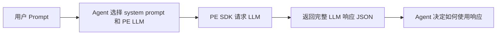

# PE Enhance SDK

一个只负责调用 Prompt Enhancement（PE）LLM 的轻量 Python SDK。调用方提供用户 Prompt；system prompt 可选。SDK 默认只向 PE LLM 发送文字，不会读取或编码原图、参考图。SDK 调用兼容 OpenAI 的 LLM 接口，并**原样返回模型的完整 JSON 响应体**（含 `id`、`choices`/`output`、`usage` 等）。SDK 不选择图像模型、不解析或验证改写文本、不调用文生图或图片编辑服务。



## 安装

开发时可在源码目录执行 `python -m pip install -e .`。`dist/` 中的 0.2.4 wheel 按当前源码重新打包。

这个项目可以打成一个**纯 Python wheel**，同一个文件可安装在 Windows 和 Ubuntu（Python 3.10+）：

```bash
python -m pip install build setuptools wheel
python -m build --wheel
```

产物位于 `dist/pe_enhance-0.2.4-py3-none-any.whl`。将这个文件复制到目标机器后安装：

Windows PowerShell：

```powershell
py -m pip install --upgrade .\pe_enhance-0.2.4-py3-none-any.whl
py -c "from pe_enhance import LLMConfig, PromptEnhancer, load_system_prompt; print(load_system_prompt('text_to_image')[:80])"
```

Ubuntu：

```bash
python3 -m pip install --upgrade ./pe_enhance-0.2.4-py3-none-any.whl
python3 -c "from pe_enhance import LLMConfig, PromptEnhancer, load_system_prompt; print(load_system_prompt('text_to_image')[:80])"
```

`pip` 会安装 SDK 依赖的 `httpx`；若机器不能访问依赖源，需要提前准备对应依赖包。`py3-none-any` 表示 wheel 本身没有操作系统专属二进制代码。打包时已包含通用文生图和图片编辑两份提示词模板。

需要 OpenAI 兼容的 `/v1/chat/completions` 或 `/v1/responses` 接口。API Key 从环境变量读取。

## 用法

```python
import os
from pe_enhance import LLMConfig, PromptEnhancer, load_system_prompt

# 环境中设置 PE_API_KEY 和 PE_BASE_URL，例如 https://pe.example.com/v1
sdk = PromptEnhancer(LLMConfig(
    base_url=os.environ["PE_BASE_URL"],
    model="pe-model-v1",
    api_key_env="PE_API_KEY",
))

user_request = {
    "prompt": "生成一张中文书展海报，标题是‘阅读之夜’",
    "size": "2048x4096",
}
response = sdk.enhance(
    user_request["prompt"],
    system_prompt=load_system_prompt("text_to_image"),
    size=user_request["size"],
)
print(response)  # 完整的 LLM 响应体，不只是 choices[0].message.content
```

图片编辑 PE 可只发送用户文字指令，适用于**不支持视觉输入的 PE LLM**。内置图片编辑模板会要求 PE LLM 避免猜测原图内容；调用方再把增强后的文字与原图交给图片编辑模型：

```python
response = sdk.enhance(
    "把天空改成晚霞，保持人物不变",
    system_prompt=load_system_prompt("image_edit"),
    size="2048x4096",
)
```

使用 Responses API 时设置 `LLMConfig(..., api_style="responses")`。如果需要不同 PE LLM，可分别构建多个 `PromptEnhancer` 实例。system prompt 也可以直接传入自己的字符串；内置的两个模板只是可选示例，不会根据目标图像模型自动切换。文生图模板采用通用增强规则，按信息缺口补足视觉细节，并吸收 MOSS-Image 的意图判断、信息层级规划与文字精确保留原则；不输出模型专属坐标或语法。模型仍输出 Render JSON，包含主体、场景、构图、风格、光色、细节、可见文字、画布及约束。图片编辑模板为纯文字 PE，要求保留用户原始语言及用户指定的可见文字，不推断未见过的图像内容，仍输出自然语言编辑指令。SDK 原样返回 LLM 接口的完整 JSON 响应；文生图的 Render JSON 位于响应内容中，调用方需要自行解析、校验，并按下游图像模型的输入要求使用或组装提示词。模板选择方式仍为 `load_system_prompt("text_to_image")`。

指定画布宽高时，传入可选的 `size="2048x4096"`。文生图和图片编辑采用相同处理：SDK 在同一条 user message 中先列出解析后的宽、高，再附上用户原始需求，固定的 system prompt 不会因尺寸变化而改写。画布参数会标明为布局约束，不是图片中的可见文字；若原始需求中的尺寸与参数冲突，以参数为准。`size` 必须包含两个正整数边长，分隔符支持 `x`、`×` 或 `*`。未传时，user message 保持为原始提示词。SDK 返回的是模型原始 JSON；实际出图尺寸仍需在后续图像生成或编辑调用中设置。

请求前只要求 `prompt`、`base_url`（请求 URL 的基础地址）和**最终请求体**中的 `model` 非空。其他配置不做必填校验；例如不传 `system_prompt` 时不会发送 system 消息，`api_key_env` 对应的环境变量未设置时不会发送 Authorization 头，服务端如要求鉴权会返回 HTTP 错误。

其他 LLM 请求参数可以直接传给 `enhance()`，它们会原样放进 JSON 请求体，不按字段名过滤：

```python
response = sdk.enhance(
    "生成一张海报",
    system_prompt=load_system_prompt("text_to_image"),
    model="pe-model-v2",  # 覆盖配置里的默认模型
    top_p=0.7,
    chat_template_kwargs={"enable_thinking": True},  # 原样透传给上游 LLM
    request_body={"vendor_option": {"enabled": True}},  # 也可传整个参数字典
)
```

合并顺序为 SDK 默认值、`LLMConfig.extra_body`、`request_body`、本次调用的额外关键字参数；同名字段以最后传入的值为准。`prompt`、`system_prompt`、`size` 和 `request_body` 是 SDK 方法参数，如需发送同名 JSON 字段，可放进 `request_body`。`LLMConfig.model` 可以留空，只要最终请求体通过 `extra_body`、`request_body` 或调用参数提供非空 `model` 即可。覆盖 `messages` 或 `input` 时，SDK 会按你传的内容直接发送，也会覆盖 SDK 组装的画布参数。

SDK 不默认发送 `temperature`；需要时可在单次调用中传 `temperature=0.2`，该字段会直接透传到请求体。

`chat_template_kwargs={"enable_thinking": True}` 或 `False` 都不会由 SDK 解析或过滤；是否真正启用思考由上游 LLM 服务决定。也可以把同一个字典放进 `request_body`。

SDK 仍以一次请求返回一个完整 JSON 响应；如果向上游传 `stream=true`，上游通常返回事件流，这种响应无法按 JSON 解析。

## 日志与错误

设置 `PE_ENHANCE_DEBUG=1`（也支持 `true`、`yes`、`on`）后，每次请求会通过 `pe_enhance` logger 按顺序输出：

1. `input_prompt`：发出 HTTP 请求前记录输入的用户 Prompt。
2. `system_prompt`：发出 HTTP 请求前记录本次实际发送的 system prompt；未传时显示 `<not sent>`。
3. `output_prompt`：收到成功响应后，从响应中提取改写文本，仅用于日志；SDK 返回值仍是完整响应体。请求失败时没有这一项。

日志默认通过标准错误输出，调用方也可以配置 `logging.getLogger("pe_enhance")` 的 handler 和格式。未开启时，不输出上述 INFO 日志。**HTTP 非 2xx 响应始终通过 logger 输出 ERROR 状态码和服务端错误响应体，并抛出 `httpx.HTTPStatusError`**，不受日志开关影响。网络错误和非 JSON 响应也会记录 ERROR 后抛出异常。调试日志可能包含用户原文及系统提示词，请只在合适的运行环境开启。

在 pytest 中实时查看日志，可先设置 `PE_ENHANCE_DEBUG=1`，再运行 `pytest -s`。

## 文件

```text
src/pe_enhance/
├── __init__.py
├── enhancer.py                              # LLM 配置、请求、响应与日志
├── universal_image_prompt_v1_1.txt          # 文生图 Render JSON system prompt（保留原文件名）
└── sensenova_u1_5_image_edit_prompt.txt    # 可选的图片编辑 system prompt
```

图片编辑模板改写自 SenseNova-U1 工程，版权说明见 [NOTICE](NOTICE) 和 [LICENSE](LICENSE)。

## 测试

```bash
pip install -e '.[test]'
pytest -q
```
